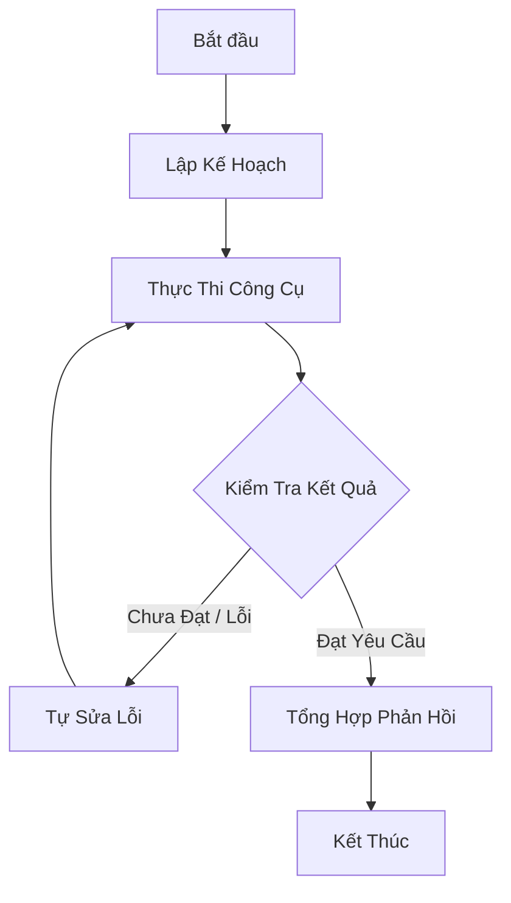

# Tác Tử Đồ Thị Trạng Thái & MCP (Agentic StateGraph & Model Context Protocol)

Khi giải quyết các tác vụ phức tạp đòi hỏi nhiều bước suy luận (multi-step reasoning) và tự sửa lỗi (self-correction), mô hình chuỗi tuyến tính truyền thống (Linear Chains) thường bộc lộ nhiều hạn chế.

Vietnamese AI Framework tích hợp kiến trúc **Agentic StateGraph** — hệ thống tác tử đồ thị trạng thái có hướng với khả năng rẽ nhánh có điều kiện, vòng lặp tự sửa lỗi, cùng chuẩn giao tiếp mở **Model Context Protocol (MCP)**.

---

## 1. Kiến trúc Đồ Thị Trạng Thái (StateGraph)

StateGraph mô hình hoá luồng thực thi của tác tử thành các Nút (Nodes) và Cạnh (Edges):
- **Trạng thái dùng chung (Shared State)**: Cấu trúc dữ liệu bất biến được truyền qua từng nút.
- **Cạnh điều kiện (Conditional Edges)**: Định tuyến luồng xử lý dựa trên đầu ra của bước trước (ví dụ: *"Nếu code lỗi -> chuyển sang Nút Sửa Lỗi; nếu code đạt kiểm thử -> chuyển sang Nút Hoàn Tất"*).
- **Phát hiện vòng lặp vô hạn (Cycle & Recursion Guard)**: Đảm bảo tác tử không bị kẹt trong vòng lặp vô tận khi gặp bài toán không giải được.



---

## 2. Xây dựng Workflow với StateGraph

```python
from vietnamese_ai.agents.state_graph import DoThiTrangThai, KetThuc

# Định nghĩa trạng thái ban đầu
trang_thai_khoi_tao = {
    "cau_hoi": "Phân tích doanh thu và lập báo cáo tài chính quý 3",
    "ke_hoach": [],
    "du_lieu_tho": None,
    "bao_cao": None,
    "so_lan_thu": 0
}

do_thi = DoThiTrangThai(trang_thai_khoi_tao)

# Đăng ký các nút xử lý
def nut_lap_ke_hoach(state):
    state["ke_hoach"] = ["Thu thập dữ liệu", "Phân tích chỉ số", "Viết báo cáo"]
    return state

def nut_thu_thap_du_lieu(state):
    state["du_lieu_tho"] = {"doanh_thu": 12500000000, "loi_nhuan": 3200000000}
    return state

def nut_tong_hop(state):
    state["bao_cao"] = f"Báo cáo Q3: Doanh thu {state['du_lieu_tho']['doanh_thu']:,} VNĐ"
    return state

do_thi.them_nut("ke_hoach", nut_lap_ke_hoach)
do_thi.them_nut("thu_thap", nut_thu_thap_du_lieu)
do_thi.them_nut("tong_hop", nut_tong_hop)

# Kết nối các cạnh
do_thi.them_canh("ke_hoach", "thu_thap")
do_thi.them_canh("thu_thap", "tong_hop")
do_thi.them_canh("tong_hop", KetThuc)

# Thực thi đồ thị
ket_qua = do_thi.chay(diem_bat_dau="ke_hoach")
print(ket_qua["bao_cao"])
```

---

## 3. Các Tác Tử Chuyên Dụng Sẵn Có

### 1. `DeepResearchAgent` (Tác tử Nghiên cứu Sâu)
Tự động phân tách một câu hỏi phức tạp thành danh sách các câu hỏi con, tìm kiếm qua kho tri thức, kiểm tra đối chiếu nguồn thông tin và tổng hợp thành báo cáo học thuật hoàn chỉnh kèm trích dẫn.

### 2. `CodeHealingAgent` (Tác tử Tự Lành Mã Nguồn)
Nhận diện thông tin ngoại lệ (Traceback/Exception), tự động phân tích file bị lỗi, tạo bản vá (patch diff) và chạy lại bộ unit test. Quá trình lặp lại cho đến khi toàn bộ bài test vượt qua hoặc chạm ngưỡng `max_retries`.

```python
from vietnamese_ai.agents.code_healing import CodeHealingAgent

healer = CodeHealingAgent(gioi_han_thu_lai=3)
ket_qua_va = healer.chua_lanh(
    duong_dan_tep="vietnamese_ai/core/pipeline.py",
    thong_bao_loi="IndexError: list index out of range at line 42"
)

if ket_qua_va.thanh_cong:
    print(f"Đã sửa lỗi thành công qua {ket_qua_va.so_lan_thu} lần thử.")
```

---

## 4. Tích hợp Chuẩn Model Context Protocol (MCP)

Vietnamese AI tương thích chuẩn **Model Context Protocol (MCP)**, cho phép kết nối với hệ sinh thái công cụ toàn cầu:
- **Tài nguyên (Resources)**: Đọc dữ liệu từ cơ sở dữ liệu nội bộ, tệp tài liệu, bảng tính.
- **Công cụ (Tools)**: Cung cấp các hàm phân tích tiếng Việt chuyên sâu dưới dạng JSON-RPC tool schema tiêu chuẩn.
