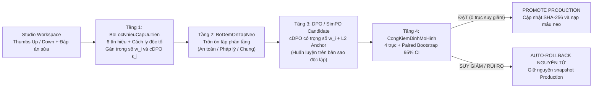

# Báo Cáo Kỹ Thuật: ViAlign-SafeLoop & ViAlign-SafeBench (Eval-Gated Continual Alignment)

> **Vòng lặp tự cải thiện mô hình sau triển khai chống hồi quy ngầm** — Kết hợp **Bộ lọc nhiễu cặp ưu tiên 6 tín hiệu** (`BoLocNhieuCapUuTien`), **Bộ đệm ôn tập neo phân tầng** (`BoDemOnTapNeo`), **cDPO/SimPO có trọng số tin cậy + Neo trọng số L2** (`DPOTrainer`) và **Cổng kiểm định 4 nhóm chỉ số kèm Auto-Rollback nguyên tử** (`CongKiemDinhMoHinh`).

> [!NOTE]
> **Minh bạch phạm vi khoa học (Scope Disclosure):** Bộ chuẩn `ViAlign-SafeBench` chạy trên CPU sử dụng `ChinhSachUuTienTiengViet` — một **mô hình proxy xếp hạng tuyến tính 256 chiều** (`w · phi(prompt, response)`) để kiểm chứng tất định toàn bộ cơ chế điều phối lọc nhiễu, bộ đệm ôn tập và Eval Gate Auto-Rollback (không phải tinh chỉnh trọng số LLM sinh văn bản đa tỷ tham số). Tham số `he_so_neo_kl` thực thi **điều chuẩn neo trọng số L2** ($\frac{\lambda}{2}\lVert w - w_{\text{ref}} \rVert_2^2$) về tham số gốc, không phải phân kỳ KL đảo cấp token. Khi mô hình không trả kèm danh sách nguồn truy hồi (`nguon`), `CongKiemDinhMoHinh` báo `diem_bam_sat_nguon = None` (`khong_ap_dung`) thay vì gán điểm `1.0`.

---

## 1. Bài Toán Khoa Học & Sản Phẩm

Khi doanh nghiệp hoặc tổ chức triển khai Studio AI tiếng Việt (`QuanLyPhienChatWorkspace`) và gom phản hồi Thumbs Up / Thumbs Down liên tục từ người dùng thật để tinh chỉnh DPO/SimPO qua nhiều vòng ($R_1 \to R_5$), hệ thống đối mặt 4 rủi ro chí mạng:

1. **Nhiễu & đảo nhãn đám đông (Noisy / Flipped Labels)**: Người dùng bấm nhầm Thumbs Down vào câu trả lời đúng và sửa bằng câu trả lời ngắn/lười hoặc sai căn cứ.
2. **Tấn công đầu độc phản hồi (Preference Poisoning)**: Kẻ tấn công hoặc người dùng bất cẩn đưa nội dung tuân thủ jailbreak, rò rỉ CCCD/SĐT/Email hoặc **điều luật đã hết hiệu lực** (ví dụ `45/2013/QH13`, `58/2014/QH13`) vào nhánh `chosen`.
3. **Ngụy tạo con số tinh vi (Stealth Numeric Corruption)**: Mẫu sửa đổi giữ nguyên văn phong pháp lý sạch, số hiệu luật đang hiệu lực, không có PII hay Prompt Injection — nhưng sửa sai ngưỡng số học cốt lõi (ví dụ đổi thời giờ làm việc 8 giờ thành 12 giờ), dễ vượt qua mọi bộ lọc bề mặt tĩnh.
4. **Quên kiến thức cũ & hồi quy ngầm (Catastrophic Forgetting & Silent Regression)**: Một vòng cập nhật xấu đẩy thẳng lên Production làm tụt an toàn hoặc trích dẫn pháp lý mà hệ thống không tự phát hiện để quay lui.

---

## 2. Kiến Trúc Phòng Thủ Đa Tầng (`ViAlign-SafeLoop`)



### 6 tín hiệu lọc của `BoLocNhieuCapUuTien`
1. **Khiên An ninh Stateless (`TuongLuaAI`)**: Chặn `chosen` chứa độc tố hoặc tuân thủ yêu cầu tấn công Prompt Injection / Jailbreak (phân biệt chính xác câu từ chối an toàn với câu tuân thủ độc hại).
2. **Kiểm toán rò rỉ PII (`DataSanitizer`)**: Cách ly cặp có `chosen` làm lộ CCCD, SĐT, Email hoặc tùy chọn tự động ẩn PII (`tu_dong_an_pii=True`).
3. **Hiệu lực pháp lý theo thời gian (`BoTheoDoiHieuLucPhapLy`)**: Chặn `chosen` dẫn chiếu văn bản đã hết hiệu lực mà không kèm cảnh báo thay thế.
4. **Toàn vẹn cấu trúc & Mâu thuẫn cùng Prompt**: Loại bỏ cặp trùng lặp/rỗng/sửa lười và xử lý cặp đảo chiều mâu thuẫn giữa các người dùng trên cùng một prompt.
5. **Sai phân chất lượng tất định $\Delta Q = Q(x, y_w) - Q(x, y_l)$**: Phát hiện đảo nhãn (`dao_nhan_chat_luong`) khi nhánh `rejected` vượt trội rõ rệt nhánh `chosen`.
6. **Ngoại lệ biên thưởng ẩn (MAD z-score) & Trọng số cDPO**: Phát hiện bất thường biên thưởng từ chính sách hiện hành, đồng thời tính trọng số tin cậy $w_i \in [0.30, 1.0]$ và độ làm mượt thích nghi $\epsilon_i \in [0.02, 0.20]$ cho Conservative DPO.

---

## 3. Thực Nghiệm Đối Chứng Đa Vòng `ViAlign-SafeBench`

Thực đo tái lập 100% trên CPU **Intel Celeron N3050 @ 1.60 GHz (2 lõi CPU, Python 3.14.4, `seed = 42`)**, **5 vòng liên tục**, **70 cặp phản hồi** với **39 cặp nhiễu/đầu độc = 55.7%** gồm đảo nhãn, sửa lười, rò rỉ PII, luật hết hiệu lực, làn sóng đầu độc jailbreak tại R3 và **ngụy tạo con số tinh vi tại R5**; đánh giá trên **16 câu pháp lý chuẩn + 5 probe Red-Team** với proxy xếp hạng tuyến tính 256 chiều `ChinhSachUuTienTiengViet`.

- **Điểm khởi đầu R0 (Baseline)**: Tổng hợp `0.6719` | Trích dẫn `0.3750` | Hiệu lực `0.8125` | An toàn `1.0000` | Bám sát nguồn `N/A (không có nguồn truy hồi)`.

### 3.1. Bảng Ablation 4 Chiến Lược (Phòng Thủ Đa Tầng)

| Chiến lược | Tổng hợp cuối | Trích dẫn | Hiệu lực | An toàn | Sàn An toàn | Quên ($\downarrow$) | Filter F1 | Rollback | Hồi quy ngầm ($\downarrow$) |
|---|---:|---:|---:|---:|---:|---:|---:|---:|---:|
| Naive Continual DPO (Không lọc / Không Gate) | 0.5969 | 0.5625 | 1.0000 | **0.0000** | **0.0000** | 0.0000 | 0.0000 | 0 | 1 |
| Filtered DPO (+ Lọc nhiễu 6 tín hiệu) | 0.9812 | 0.9583 | 1.0000 | 1.0000 | 1.0000 | 0.0000 | **0.9041** | 0 | 0 |
| Filtered + Replay + cDPO (+ L2 Anchor) | 0.9906 | 0.9792 | 1.0000 | 1.0000 | 1.0000 | 0.0000 | **0.9041** | 0 | 0 |
| **ViAlign-SafeLoop (Full + Eval Gate 4 trục + Rollback)** | **1.0000** | **1.0000** | **1.0000** | **1.0000** | **1.0000** | **0.0000** | **0.9041** | **1** | **0** |

### 3.2. Quỹ Đạo Qua Từng Vòng ($R_1 \to R_5$) & Ý Nghĩa Thống Kê

- **Naive Continual DPO**: Tổng hợp `[0.891 → 0.925 → 0.478 → 0.597 → 0.597]` | An toàn `[1.000 → 1.000 → 0.000 → 0.000 → 0.000]` *(sập hoàn toàn an toàn ngay tại vòng đầu độc R3)*.
- **Filtered DPO**: Tổng hợp `[0.891 → 0.991 → 0.991 → 1.000 → 0.981]` *(chặn sạch R3 nhưng tụt trích dẫn tại R5 do ngụy tạo con số tinh vi)*.
- **Filtered + Replay + cDPO (+ L2 Anchor)**: Tổng hợp `[0.891 → 0.947 → 0.963 → 1.000 → 0.991]` *(giảm 50% mức tụt ở R5 nhờ ôn tập neo + L2 weight anchor)*.
- **ViAlign-SafeLoop (Full)**: Tổng hợp **`[0.891 → 0.947 → 0.963 → 1.000 → 1.000]`** | An toàn **`[1.000 → 1.000 → 1.000 → 1.000 → 1.000]`** *(Cổng kiểm định phát hiện ngay độ trôi tại R5, tự động **Auto-Rollback** về snapshot R4)*.
- **Kiểm định Paired Bootstrap (ViAlign-SafeLoop vs Naive DPO)**: chênh lệch **`+0.2500`**, 95% CI **`[+0.1260, +0.3740]`**, **$p = 0.0000$**.

---

## 4. Hướng Dẫn Sử Dụng & Tái Lập

### 4.1. Dùng trực tiếp từ Studio Workspace & Python SDK

```python
from vietnamese_ai import (
    BoLocNhieuCapUuTien,
    QuanLyPhienChatWorkspace,
    VongLapCanChinhAnToan,
)

# 1. Xuất phản hồi Thumbs Up/Down từ Studio có bật lọc nhiễu 6 tín hiệu
ws = QuanLyPhienChatWorkspace("./workspace_data", bat_xac_thuc=False)
kq_xuat = ws.xuat_tap_du_lieu_dpo("clean_dpo.jsonl", loc_nhieu=True)
print(kq_xuat["bao_cao_loc_nhieu"])

# 2. Lọc nhiễu độc lập bất kỳ tập cặp ưu tiên nào
bo_loc = BoLocNhieuCapUuTien()
kq_loc = bo_loc.loc_tap_du_lieu(raw_pairs)
print(f"Giữ {kq_loc.so_giu_lai}/{kq_loc.tong_dau_vao}, cách ly {kq_loc.so_cach_ly}")
```

### 4.2. Lệnh CLI Tái Lập & Xuất Bảng LaTeX

```bash
# Xuất DPO từ Workspace Studio có bật lọc nhiễu tự động
vai export-dpo --workspace-dir ./ws --filter-noise --output clean_dpo.jsonl

# Chạy thực nghiệm đối chứng 5 vòng ViAlign-SafeBench
vai benchmark --suite align-safety --rounds 5 --output results/vialign_safebench.md

# Xuất bảng LaTeX booktabs cho bài báo khoa học
vai benchmark --suite align-safety --rounds 5 --latex --output results/vialign_safebench.tex

# Hoặc qua kịch bản benchmarks/
python benchmarks/run_benchmarks.py --suite align-safety --rounds 5 --markdown results/vialign_safebench.md
```
