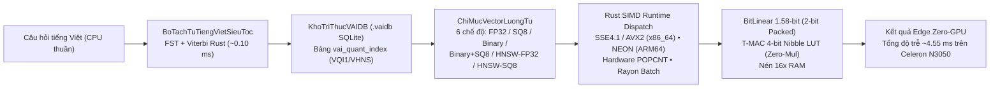

# Báo Cáo Kỹ Thuật: ViEdge-RustEngine & ViEdge-SysBench (Zero-GPU Edge AI & Rust Quantized Retrieval)

> **Hệ thống AI tiếng Việt thuần CPU không cần GPU** — Tích hợp lượng tử hóa vector nội sinh Rust (`SQ8 SSE4.1/AVX2`, `Binary 1-bit POPCNT`, `Two-Stage Rescore`), đồ thị **Native Rust HNSW-SQ8** bền vững trong 1 tệp `.vaidb`, và nhân ma trận **BitNet 1.58-bit đóng gói 2-bit T-MAC Nibble LUT** không phép nhân.

---

## 1. Động Lực Hệ Thống (Systems for AI)

Các văn phòng, bệnh viện, trường học và cơ quan tại Việt Nam thường chỉ có máy tính văn phòng hoặc Mini PC chạy **CPU phổ thông không có GPU rời** (ví dụ Intel Celeron / Core i3–i5, RAM 4–8 GB) nhưng vẫn yêu cầu:

1. **Bảo mật dữ liệu 100% tại chỗ (Air-Gapped / Offline)** — không gửi hồ sơ khách hàng hay văn bản nội bộ lên đám mây.
2. **Chi phí RAM cực thấp** — lưu hàng chục đến hàng trăm nghìn vector ngữ nghĩa tiếng Việt và trọng số mô hình nhỏ gọn trong vài MB RAM.
3. **Độ trễ tương tác dưới 10 ms** — chạy trọn chuỗi *Tách từ tiếng Việt FST/Viterbi → Truy hồi vector `.vaidb` → Suy luận tuyến tính nén cực thấp* mà không giật lag.

**ViEdge-RustEngine** giải quyết trực tiếp bài toán này bằng lõi native Rust (`rust_core/src/edge_quant.rs`, đóng gói bánh xe `abi3-py39` tương thích Python 3.9–3.14 và tự động dự phòng sang thuần NumPy 100% tương đương khi chưa biên dịch Rust).

---

## 2. Kiến Trúc Tổng Thể



### Các thuật toán cốt lõi cài đặt trong `rust_core/src/edge_quant.rs`

1. **Lượng tử hóa vô hướng 8-bit (`SQ8`) với SIMD runtime dispatch (`SSE4.1` / `AVX2` / NEON)**:
   - Mỗi vector chuẩn hóa L2 được nén đối xứng về `int8` kèm hệ số tỷ lệ `f32` (`scale = max(|v|) / 127.0`), giảm **4.0× RAM**.
   - Tích vô hướng nguyên `i8 × i8 → i32` tự động chọn lệnh phần cứng lúc chạy (`_mm256_madd_epi16` trên AVX2, `_mm_cvtepi8_epi16` + `_mm_madd_epi16` trên SSE4.1, và `chunks_exact(8)` auto-vectorized trên ARM64).
2. **Lượng tử hóa nhị phân 1-bit (`Binary POPCNT`) & Hai tầng bất đối xứng (`Binary + SQ8 Rescore`)**:
   - Nén mỗi chiều xuống đúng 1 bit đóng gói trong từ 64-bit `u64`, giảm **32.0× RAM** (`29.30 MB → 0.92 MB` cho 20,000 × 384 vector).
   - Tính khoảng cách Hamming bằng lệnh phần cứng `u64::count_ones()` (`POPCNT`), sau đó tùy chọn chấm lại top `oversample × k` ứng viên bằng SQ8 để khôi phục **Recall@10 = 96.88%**.
3. **Đồ thị HNSW đa tầng Native Rust (`RustHNSWIndex`) bền vững trong `.vaidb`**:
   - Cài đặt thuật toán **Malkov & Yashunin (2018) Alg. 4 Diversity Heuristic** cho **cả cạnh thuận lẫn cắt tỉa cạnh ngược**, bảo toàn cầu nối liên cụm (inter-cluster bridges) trên không gian nhúng phân cụm đa chủ đề.
   - Hỗ trợ tìm kiếm theo lô song song Rayon (`search_batch_bytes`) và tuần tự hóa nhị phân nguyên khối định dạng `VQI1`/`VHNS` lưu thẳng vào bảng SQLite `vai_quant_index` của `KhoTriThucVAIDB` (tự động nạp lại sau khi mở tệp `.vaidb`, và tự vô hiệu hóa an toàn khi chèn tài liệu mới).
4. **BitNet 1.58-bit đóng gói 2-bit thực (`4 trọng số/byte`, nén 16× RAM) với nhân T-MAC 4-bit Nibble LUT**:
   - Trọng số tam phân $\{-1, 0, +1\}$ được mã hóa 2-bit theo hàng (`0 → -1`, `1 → 0`, `2 → +1`).
   - Thay vì dùng nhánh điều kiện `if/else` gây dự đoán sai nhánh, mỗi hàng đầu vào $x$ xây dựng bảng tra cứu **4-bit Nibble LUT** kích thước nhỏ gọn (`packed_cols × 2 × 16 × 4 bytes`, chỉ `64 KB` cho chiều `2048` — nằm trọn trong L1/L2 cache CPU) và dùng chung chỉ đọc cho toàn bộ `out_features` trên nhiều lõi Rayon: **0 phép nhân trọng số, 0 nhánh rẽ, độ chính xác khớp tuyệt đối $\le 2 \times 10^{-6}$**.

---

## 3. Kết Quả Thực Nghiệm `ViEdge-SysBench` Trên Phần Cứng CPU Thực Tế

Đo trực tiếp không giả lập trên phần cứng Edge công suất thấp **Intel Celeron N3050 @ 1.60 GHz (6W TDP, 2 lõi CPU, 1 MB L2, SSE4.2 + POPCNT, không AVX2, không GPU)**, Python `3.14.4`, `seed = 42`.

### 3.1. Truy hồi Vector Lượng tử hóa & Native Rust HNSW (`20,000` vector × `384` chiều, `80` truy vấn, `top_k = 10`)

| Phương pháp | Vec RAM (MB) | Tổng RAM (MB) | Nén Vec | Build (s) | p50 (ms) | p95 (ms) | p99 (ms) | QPS đơn | QPS lô | Recall@10 |
|---|---:|---:|---:|---:|---:|---:|---:|---:|---:|---:|
| FP32 Exact (NumPy BLAS) | 29.30 | 29.30 | 1.0× | 1.504 | 36.448 | 79.109 | 91.816 | 23.6 | 43.1 | 1.0000 |
| FP32 Exact (Rust Rayon) | 29.30 | 29.30 | 1.0× | 0.330 | 27.570 | 55.698 | 68.317 | 31.3 | 29.5 | 1.0000 |
| **SQ8 8-bit (Rust SSE4.1 4× RAM)** | **7.40** | **7.40** | **4.0×** | 0.433 | **6.090** | 18.559 | 35.635 | **119.0** | **165.8** | **0.9688** |
| **Binary 1-bit POPCNT (Rust 32× RAM)** | **0.92** | **0.92** | **32.0×** | 0.132 | **4.768** | 15.626 | 22.030 | **155.2** | **203.0** | 0.4262 |
| **Binary+SQ8 Rescore (Rust Two-Stage)** | **8.32** | **8.32** | **3.5×** | 0.622 | **4.145** | **6.606** | **7.246** | **231.6** | 133.6 | **0.9688** |
| **Native Rust HNSW-SQ8 (4× RAM + $O(\log N)$)** | **7.40** | **9.92** | **4.0×** | 44.414 | **0.311** | **2.479** | **3.373** | **1,464.8** | **2,027.6** | **0.9688** |

**Điểm nhấn khoa học**:
- **Native Rust HNSW-SQ8** đạt độ trễ trung vị **`0.311 ms`** (**nhanh gấp 117×** so với `FP32 NumPy BLAS 36.45 ms`), thông lượng lô **`2,027.6 QPS`** (**gấp 47×**), tiết kiệm **75% RAM vector (`4.0×`)** mà vẫn giữ nguyên **`Recall@10 = 0.9688`** (ngang bằng quét cạn SQ8).
- **Binary+SQ8 Two-Stage Rescore** không cần dựng đồ thị HNSW (`build = 0.62s`), đạt **`p50 = 4.145 ms`** (`p99 = 7.246 ms`), **`231.6 QPS`** (**gấp 9.8× FP32 NumPy**) với **`Recall@10 = 0.9688`**.
- **SQ8 8-bit SSE4.1** quét chính xác toàn bộ 20,000 vector chỉ trong **`6.09 ms`** (**nhanh gấp 6.0× FP32 NumPy**).

### 3.2. BitNet 1.58-bit Đóng Gói 2-bit Thực (Rust T-MAC 4-bit Nibble LUT Zero-Mul)

| Kích thước tầng | FP32 (MB) | 2-bit Packed (MB) | Nén RAM | FP32 NumPy (ms) | BitNet NumPy (ms) | BitNet Rust LUT (ms) | Tăng tốc vs BN-NumPy | Sai số tối đa |
|---|---:|---:|---:|---:|---:|---:|---:|---:|
| `512×512` | 1.000 | 0.0625 | **16.0×** | 3.029 | 10.481 | **1.640** | **6.39×** | `5.00e-07` |
| `1024×1024` | 4.000 | 0.2500 | **16.0×** | 10.961 | 53.746 | **11.095** | **4.84×** | `1.00e-06` |
| `2048×2048` | 16.000 | 1.0000 | **16.0×** | 20.860 | 251.969 | **25.309** | **9.96×** | `1.90e-06` |

> Ở tầng `512×512`, nhân ma trận **BitNet 1.58-bit 2-bit Rust T-MAC LUT** chạy **nhanh gấp 1.85× cả `FP32 OpenBLAS`** (`1.640 ms` vs `3.029 ms`) trong khi chỉ tốn **1/16 dung lượng RAM** (`64 KB` vs `1 MB`). Ở `2048×2048`, nhanh gấp **9.96×** so với bản NumPy và giữ sai số đối chiếu chỉ `1.90e-06`.

### 3.3. Chuỗi Suy Luận Tiếng Việt Zero-GPU Đầu-Cuối trên CPU

| Mắt xích trong chuỗi Zero-GPU | Độ trễ thực đo | Ghi chú hệ thống |
|---|---:|---|
| 1. Tách từ tiếng Việt Viterbi + FST (Rust) | `0.1025 ms` | Khớp 100% đường Python |
| 2. Truy vấn `.vaidb` Native Rust HNSW-SQ8 | `0.1640 ms` | Nạp lạnh từ đĩa `173.5 ms` (`1,984 KB`, nén `3.88×`) |
| 3. Suy luận tầng BitNet 1.58-bit 2-bit (`512×512`) | `4.2819 ms` | T-MAC Nibble LUT, 0 phép nhân |
| **Tổng độ trễ đầu-cuối (End-to-End)** | **`4.5486 ms`** | **> 200 lượt xử lý/giây trên Celeron 6W không GPU** |

---

## 4. Hướng Dẫn Sử Dụng & Tái Lập 1 Lệnh

### 4.1. Dùng trực tiếp trên `.vaidb` và `BitLinear`

```python
import numpy as np
from vietnamese_ai import (
    BitLinear,
    ChiMucVectorLuongTu,
    KhoTriThucVAIDB,
    co_rust_bitnet,
    co_rust_luong_tu,
)

# 1. Chỉ mục vector lượng tử hóa độc lập (SQ8 / Binary+SQ8 / HNSW-SQ8)
vectors = np.random.default_rng(42).standard_normal((10000, 384)).astype(np.float32)
idx = ChiMucVectorLuongTu(che_do="hnsw_sq8", m=16, ef_construction=80, ef_search=64)
stats = idx.xay_dung(vectors)
print("Nén vector:", stats["ti_le_nen_vector"], "Rust:", co_rust_luong_tu())
top10 = idx.tim_kiem(vectors[0], top_k=10)

# Lưu & phục hồi nhị phân VQI1/VHNS
blob = idx.luu_bytes()
idx_reloaded = ChiMucVectorLuongTu.tai_bytes(blob)

# 2. Gắn trực tiếp HNSW-SQ8 bền vững vào 1 tệp .vaidb
store = KhoTriThucVAIDB("tri_thuc_noi_bo.vaidb")
store.xay_dung_chi_muc_luong_tu(che_do="hnsw_sq8", luu_xuong_dia=True)

# 3. BitNet 1.58-bit đóng gói 2-bit thực (16x RAM + T-MAC LUT Rust)
layer = BitLinear(1024, 1024)
print(layer.thong_ke_nen(), "Rust BitNet:", co_rust_bitnet())
x = np.random.default_rng(1).standard_normal((4, 1024)).astype(np.float32)
y = layer.suy_luan_2bit(x)
```

### 4.2. Tái lập `ViEdge-SysBench` và xuất bảng LaTeX cho bài báo

```bash
# Chạy nhanh kiểm thử trên CPU
vai benchmark --suite edge-systems --quick

# Chạy đầy đủ quy mô 20,000 vector x 384 chiều
vai benchmark --suite edge-systems --scale 20000 --dim 384 --output results/viedge_20k.md

# Chạy quy mô lớn 100,000 vector x 384 chiều (tự động đối đầu faiss/hnswlib nếu máy có cài)
vai benchmark --suite edge-systems --scale 100000 --dim 384 --output results/viedge_100k.json

# Xuất bảng LaTeX booktabs phục vụ bài báo MLSys / Efficient NLP
vai benchmark --suite edge-systems --scale 20000 --dim 384 --latex --output results/viedge.tex

# Hoặc qua kịch bản tái lập benchmarks/
python benchmarks/run_benchmarks.py --suite edge-systems --scale 20000 --dim 384 --markdown results/viedge.md
```
