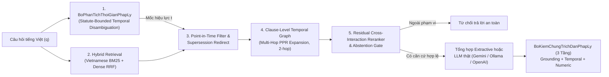

# ViLegal-TemporalRAG & ViLegal-TempBench (Báo Cáo Kỹ Thuật v31.1.0)

> **Hướng nghiên cứu ứng dụng (Applied Research → Production)**: Giải quyết bài toán **truy hồi đa bước theo mốc thời gian hiệu lực** và **kiểm chứng trích dẫn chống ảo giác** cho hệ thống văn bản quy phạm pháp luật Việt Nam — chạy tái lập 100% trên CPU không cần GPU, đồng thời hỗ trợ cắm trực tiếp LLM thực tế (**Google Gemini API**, OpenAI-compatible, Ollama).

---

## 1. Tóm tắt & Bài toán Nghiên cứu (Abstract & Problem Formulation)

Hệ thống văn bản quy phạm pháp luật Việt Nam có hai đặc trưng khiến các kiến trúc RAG tiêu chuẩn (BM25 / Dense chunking phẳng) thường xuyên thất bại ngoài thực tế:

1. **Biến động hiệu lực theo thời gian (Temporal Evolution)**: Cùng một câu hỏi pháp lý ở hai mốc thời gian $t_1 < t_{\text{sửa đổi}} \le t_2$ dẫn tới hai kết luận hoàn toàn trái ngược (ví dụ: *Nghị định 123/2020/NĐ-CP* trước vs sau *Nghị định 70/2025/NĐ-CP* ngày `01/06/2025`; *Luật BHXH 58/2014/QH13* (20 năm) vs *41/2024/QH15* (15 năm) ngày `01/07/2025`; *Luật Đất đai 45/2013/QH13* vs *31/2024/QH15* ngày `01/08/2024`).
2. **Tham chiếu đa tầng cấp Điều/Khoản (Multi-Hop Cross-References)**: Luật quy định nguyên tắc khung, còn ngưỡng định lượng và thủ tục cụ thể nằm ở Nghị định và Thông tư hướng dẫn thi hành (*Luật ↔ Nghị định ↔ Thông tư*).

**ViLegal-TemporalRAG** định nghĩa bài toán truy hồi pháp lý có điều kiện thời gian: với truy vấn tiếng Việt $q$, hệ thống tự động suy diễn mốc thời gian áp dụng $t = \tau(q)$, truy hồi tập điều khoản hợp lệ $C_t = \{c \in \mathcal{C} \mid t_{\text{start}}(c) \le t < t_{\text{end}}(c)\}$, mở rộng đa bước trên đồ thị điều khoản có điều kiện thời gian $G_t = (V_t, E_t)$, từ chối trả lời khi thiếu căn cứ, và kiểm chứng 3 tầng trước khi trả về câu trả lời cuối cùng.

---

## 2. Kiến trúc ViLegal-TemporalRAG (5 Tầng)



### Bốn đóng góp thuật toán cốt lõi
1. **`BoPhanTichThoiGianPhapLy` (`TemporalQueryParser`)**: Nhận diện mốc thời gian tự nhiên tiếng Việt (*ngày/tháng/năm, trước/từ/sau, quý, đầu/cuối năm, "hiện hành"*) kèm quy tắc **Statute-Bounded Temporal Disambiguation** — tự động loại trừ năm trong số hiệu/tên luật (*"Luật Đất đai 2024"*) và ngày điều kiện nội dung cũ hơn năm ban hành đạo luật (*"sử dụng đất trước 01/07/2014 theo Luật Đất đai 2024"*).
2. **Đồ thị Điều khoản Có Điều kiện Thời gian (`DoThiThamChieuPhapLy`)**: Nâng cấp đồ thị từ cấp văn bản lên cấp **Điều/Khoản** (`NutDieuKhoanPhapLy`, `QuanHeDieuKhoan`) với 6 loại cạnh (`phien_ban_ke_nhiem`, `sua_doi_dieu`, `thay_the_dieu`, `huong_dan_dieu`, `vien_dan_cheo`, `bai_bo_dieu`) và thuật toán lan truyền đa bước `mo_rong_da_buoc_theo_thoi_gian` có hệ số PPR restart chống đảo hạng Rank-1.
3. **Cổng Từ chối & Xếp hạng chéo dư (`BoTruyHoiPhapLyThoiGian`)**: Kết hợp tín hiệu tương tác chéo theo dạng kết nối dư (*residual cross-interaction*) cùng cổng từ chối trả lời khi phát hiện số hiệu văn bản không tồn tại hoặc câu hỏi ngoài phạm vi kho luật.
4. **Bộ Kiểm chứng Trích dẫn Tất định 3 Tầng (`BoKiemChungTrichDanPhapLy`)**:
   - **Tầng 1 — Citation Grounding**: Phát hiện số hiệu văn bản / Điều luật bịa đặt không có trong nguồn.
   - **Tầng 2 — Temporal Consistency**: Phát hiện xung đột khi câu trả lời viện dẫn điều luật hết hiệu lực mà không cảnh báo thay thế (hiểu cả thể chủ động *"A thay thế B"* và bị động *"B bị thay thế bởi A"*).
   - **Tầng 3 — Numeric & Deadline Consistency**: Đối chiếu tỷ lệ `%`, thời hạn (`ngày làm việc`, `tháng`, `năm`, `giờ`), hạn mức tiền giữa câu trả lời và điều khoản gốc.

---

## 3. Bộ Dữ liệu Mở `ViLegal-TempBench` (v1.0)

Bộ chuẩn được lưu đồng bộ trong `benchmarks/datasets/` và đóng gói sẵn trong wheel (`vietnamese_ai/rag/legal/data/`):

- **Kho chỉ mục (`160` điều khoản)**: `60` điều khoản đa phiên bản có mốc hiệu lực/hết hiệu lực thuộc 12 nhóm luật cốt lõi (*Hóa đơn điện tử, BHXH, Thuế GTGT, Đất đai, Giao dịch điện tử, Nhà ở, KDBĐS, Đấu thầu, BVQLNTD, Lao động, Doanh nghiệp, An ninh mạng/DLCN/Dân sự*) ghép cùng `100` điều khoản nền làm nhiễu thực tế.
- **Đồ thị điều khoản (`38` cạnh có điều kiện thời gian)**: Gồm cạnh sửa đổi, thay thế, hướng dẫn thi hành và viện dẫn chéo 2-hop (*BLDS 2015 Điều 119 → Luật GDĐT 2023 Điều 22 → Nghị định 137/2024 Điều 10*).
- **Tập truy vấn (`64` câu hỏi chia 4 phân nhóm)**:
  - **`T1` (16 câu)**: Tra cứu điều luật hiện hành 1-hop.
  - **`T2` (24 câu = 12 cặp tương phản thời gian)**: Cùng một câu hỏi pháp lý ở hai mốc $t_1 < t_{\text{sửa đổi}} \le t_2$ để đo **Temporal Contrast Accuracy (TCA)**.
  - **`T3` (14 câu)**: Chuỗi đa bước 1–2 hop *Luật ↔ Nghị định ↔ Thông tư* (không rò rỉ đáp án định lượng trong câu hỏi) để đo **Multi-Hop Bridge Recall@3**.
  - **`T4` (10 câu)**: `6` câu bẫy cố tình viện dẫn luật đã bãi bỏ sau ngày hết hạn (**Trap Correction Rate**) + `4` câu ngoài phạm vi / nghị định hư cấu (**Abstention F1**).

---

## 4. Kết Quả Thực Nghiệm Ablation trên CPU (`seed=42`)

Độ chính xác bóc tách mốc thời gian tự động không rò rỉ nhãn (**TQPA**): **`100.00%` (64/64)**.

| Cấu hình | R@1 | R@3 | MRR@10 | nDCG@10 | TVA | TCA (T2) | Multi-Hop@3 (T3) | Trap (T4) | Faith. | Temp.Conf ↓ | Abst. F1 | Latency (ms) |
|---|---:|---:|---:|---:|---:|---:|---:|---:|---:|---:|---:|---:|
| `bm25` (BM25-only VN Tokenizer) | 0.581 | 0.972 | 0.850 | 0.877 | 0.722 | 0.000 (0/12) | 0.786 | 0.167 | 1.000 | 0.312 | 0.000 | 6.87 |
| `hybrid` (BM25 + Dense RRF) | 0.581 | 0.947 | 0.838 | 0.871 | 0.694 | 0.167 (2/12) | 0.714 | 0.167 | 1.000 | 0.312 | 0.000 | 14.25 |
| `temporal` (+ Point-in-Time) | 0.831 | 0.981 | 0.967 | 0.970 | 1.000 | 1.000 (12/12) | 0.857 | 1.000 | 1.000 | 0.000 | 0.000 | 49.45 |
| `temporal_graph` (+ Clause Graph) | 0.831 | 1.000 | 0.967 | 0.976 | 1.000 | 1.000 (12/12) | 1.000 | 1.000 | 1.000 | 0.000 | 0.000 | 26.32 |
| **`full` (ViLegal-TemporalRAG)** | **0.831** | **1.000** | **0.967** | **0.976** | **1.000** | **1.000 (12/12)** | **1.000** | **1.000** | **1.000** | **0.000** | **1.000** | **56.62** |

### Kiểm định ý nghĩa thống kê (Paired Bootstrap, `n=1000`, `seed=42`)

| So sánh | Δ Recall@3 (`p`) | Δ MRR@10 (`p`) | Δ TVA (`p`) | Δ Multi-Hop@3 (`p`) |
|---|---:|---:|---:|---:|
| `full` vs `bm25` | `+0.0278` (`0.1160`) | **`+0.1167` (`0.0000*`)** | **`+0.2778` (`0.0000*`)** | `+0.2143` (`0.0910`) |
| `full` vs `hybrid` | **`+0.0528` (`0.0300*`)** | **`+0.1292` (`0.0000*`)** | **`+0.3056` (`0.0000*`)** | **`+0.2857` (`0.0370*`)** |

---

## 5. Tái lập 1 Lệnh (Offline CPU, Docker & Google Gemini API)

### Chạy cục bộ 100% trên CPU (xuất Markdown & LaTeX)
```bash
vai benchmark --suite legal-temporal --output results/vilegal_tempbench.md
vai benchmark --suite legal-temporal --latex --output results/vilegal_tempbench.tex
```

### Chạy đối chứng đầu-cuối bằng LLM thật qua Google Gemini API (không cần GPU)
```bash
export GEMINI_API_KEY="AIza..."
vai benchmark --suite legal-temporal --quick \
  --llm-provider gemini \
  --llm-model gemini-2.5-flash \
  --llm-delay 1.5 \
  --output results/vilegal_gemini.md
```

### Hỏi đáp trực tiếp từ CLI / REST API / Studio UI
```bash
# Tự động nhận diện mốc thời gian trong câu hỏi + kiểm chứng 3 tầng
vai legal-ask "Vào tháng 3/2025, người bán có được phép hủy hóa đơn điện tử sai sót không?"
vai legal-ask "Vào tháng 8/2025, người bán có được phép hủy hóa đơn điện tử sai sót không?"

# Có thể cắm Gemini API trực tiếp cho câu hỏi đơn lẻ
GEMINI_API_KEY="AIza..." vai legal-ask "Thuế suất GTGT phân bón từ 01/07/2025 là bao nhiêu?" --llm-provider gemini
```

### Tái lập trong Docker cô lập
```bash
docker build -f benchmarks/Dockerfile.benchmark -t vietnamese-ai-bench:31.1.0 .
docker run --rm -v "$(pwd)/results:/results" vietnamese-ai-bench:31.1.0 \
  --suite legal-temporal --seed 42 --output /results/vilegal_tempbench.json --markdown /results/vilegal_tempbench.md
```

---

## 6. Trích dẫn (BibTeX / `CITATION.cff`)

```bibtex
@software{huynh2026vilegal_temporalrag,
  author  = {Huỳnh, Dương Phong},
  title   = {Vietnamese AI Framework and ViLegal-TempBench: Temporal and Graph-Grounded RAG for Vietnamese Statutory Law},
  year    = {2026},
  version = {31.1.0},
  url     = {https://github.com/phonghhd/vietnamese-ai},
  license = {MIT}
}
```
